<picture>
  <source media="(prefers-color-scheme: dark)" srcset="assets/banner-dark.svg">
  
</picture>

 

Oi, eu sou o Roberto. Sou product designer na [Popcode](https://github.com/PopcodeMobile) e trabalho do Figma até o código: design systems, fluxos de app e protótipos que rodam de verdade.

Desenho no Figma com o design system como base e levo para o código com Claude Code. Quando uma tarefa se repete, viro automação: do Figma para o Azure DevOps, de tokens para componentes. Quase tudo é para clientes, então os repositórios são privados. Abaixo, o que dá para mostrar.

<picture>
  <source media="(prefers-color-scheme: dark)" srcset="assets/canvas-dark.svg">
  
</picture>

 

**Contato:** [LinkedIn](https://www.linkedin.com/in/robertopedral/) · [robertopedral.design@gmail.com](mailto:robertopedral.design@gmail.com)
